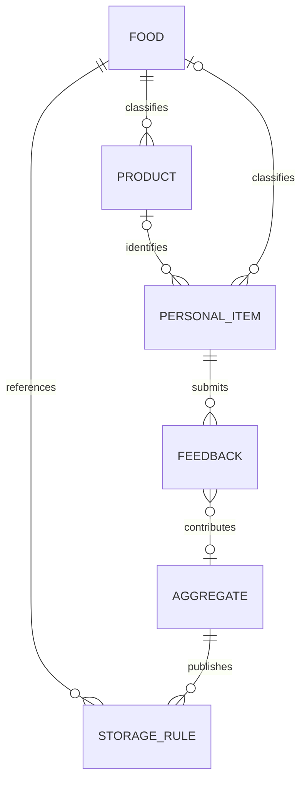

# 1단계 — 데이터 구조와 API 계약 초안

2026-11-02. D-039/D-040/D-041에 따른 설계 산출물. 이번 단계는 앱/서버 구현 이전의 검토 가능한 계약이다. 기존 Expo 앱의 동작과 미정 운영값을 변경하지 않는다. 구현용 타입: [catalog-v1.ts](../src/contracts/catalog-v1.ts), [예제](../src/contracts/catalog-v1.examples.ts), [API](STAGE_1_API.md).

## 데이터 연결

상품 검색 DB와 표준 식품 DB가 두 레이어다. 보관규칙·개인 품목·제출 기록은 두 레이어에 연결되는 별도 업무 테이블이다. 상품명 전체를 원문으로 보존하고 검색용 정규화 문자열을 따로 저장한다. ID는 이름 변경에도 유지한다. `marketplace + externalProductId`는 값이 있을 때 유일해야 한다. 동일 이름이라고 자동 병합하지 않는다.

상품→표준 식품 매핑은 등록 시 후보를 제안하고 확인 후 저장한다(P-001). 매핑이 미확인인 상품을 자동 확정의 근거로 쓰지 않는다. 표준 식품 이름은 단순하게 유지하고 보관 조건은 별도 규칙으로 나눈다(D-004/D-005).

## 검색과 참고값 결정

1. OCR에서 온라인 주문의 상품명 후보를 추출하고 원문과 잘림 여부를 보존한다. 전체 주문 이미지·배송지·결제 정보는 검색 API에 보내지 않는다.
2. 상품 DB의 부분 일치/임베딩 검색을 비교한다. 정확한 상품 ID가 입력으로 주어진 경우 그 ID 조회를 우선할 수 있다. 검색 방식·top-k·cutoff·margin은 평가 후 선택한다.
3. 후보가 모호하면 `needs_review`. 유효한 후보가 동일 표준 식품에 연결되면 `food_only`로 식품만 제안할 수 있다. 최종 상품 ID는 null로 둔다. 후보 집합의 신뢰 기준 자체도 평가 대상이다.
4. 미등록/미연결 상품은 표준 식품 직접 검색 또는 사용자 선택으로 진행한다. 입력에 없는 원문을 복원한 사실처럼 표시하지 않는다.
5. 사용자 표시 날짜가 있으면 개인 override를 사용한다. 없으면 확인된 제품·식품과 **일치하는 조건**의 published 규칙을 조회한다. 조건 불명/규칙 부재/충돌이면 unknown을 반환하며 기존 7일 fallback을 승계하지 않는다.

상품 규칙이 없는 경우 식품 규칙을 이용할 수 있지만 가공 형태·보관·개봉 조건이 일치해야 한다. 상품이 확정되지 않은 `food_only` 상태에서 특정 제품 규칙을 사용하지 않는다. 모델/토크나이저/색인/카탈로그 버전을 묶어 관리한다. 다른 모델의 질의 벡터와 이전 색인을 혼합하지 않는다.

## 날짜의 의미와 개인 수정

`purchaseDate`, `openedDate`, expiry는 시간 없는 달력 날짜로 저장한다. 제출·변경 시각은 UTC timestamp로 저장한다. 일수 계산은 날짜 간 달력 차이로 처리하고 일광절약·시간대 변환으로 날짜가 바뀌지 않게 한다. 실제 구매일이 없으면 오늘 날짜로 대신 채우지 않는다.

- `package_label`: 사용자가 포장지에 표시된 날짜를 입력했다는 주장. 포장지를 독립 검증했다는 의미는 아니다.
- `user_estimate`: 사용자의 예상 날짜. 포장지 날짜와 다른 집계 그룹에 둔다.
- `purchase_remaining`: 수정 날짜 − 확인된 구매일. 구매 당시 남은 기간이며 제조일부터의 전체 소비기한이 아니다.
- `after_opening`: 수정 날짜 − 실제 개봉일. 개봉 후 날짜의 근거가 있는 제출만 해당한다. 미개봉 포장지 날짜를 개봉 후 권장기간으로 바꾸지 않는다.

지난 날짜도 개인 기록에는 저장할 수 있다. 다만 날짜 순서가 부적절하거나 근거가 부족한 제출은 집계에서 보류한다. 표시 날짜 삭제는 개인 override 해제이며 기여분 철회는 별도 상태 전이로 처리한다. 수정 후 이전 제출은 superseded 처리해 낡은 값이 계속 반영되지 않게 한다. 개인 항목은 수정 당시 규칙 snapshot을 보관하고 공유 기본값 변경으로 사용자 입력 날짜를 덮어쓰지 않는다.

## 서버 테이블과 불변 조건

| 테이블 | 핵심 필드/제약 |
|---|---|
| foods | foodId PK, name, aliases, revision. 이름으로 PK를 만들지 않음 |
| products | productId PK, 원문, 검색문, foodId FK nullable, mappingStatus, 출처, revision |
| storage_rules | ruleId+revision, 대상 food/product, 조건, basis, days nullable, 출처, 상태, policyVersion |
| personal_items | itemId, ownerId(서버 내부), 날짜/조건/override/ruleSnapshot, revision |
| feedback | feedbackId, ownerId, itemId+itemRevision, 날짜·조건·식품 연결 snapshot, 동의 버전, 상태·사유·정책 버전 |
| contributions | feedbackId, groupKey, weight, valueDays, active. 사용자/그룹의 유효 기여 제한 적용 |
| aggregates | groupKey, distinctUserCount, acceptedCount, sumWeight, sumWeightedDays, revision, policyVersion |
| idempotency | actorId+route+key unique, requestHash, 저장된 응답. 만료 정책 별도 결정 |
| publications | 규칙 버전, 집계 snapshot, 검토 근거, 이전 버전, 배포/철회 시각 |

집계 groupKey에는 foodId, 확인된 productId(있는 경우), productForm, storage, opened, basis, overrideSource를 포함한다. 제품별 자료를 식품 전체로 합치는 것은 별도 검증 정책이며 자동 풀링하지 않는다. 사용자 식별은 서버 인증 주체에서 얻고 클라이언트가 보낸 userId를 신뢰하지 않는다. 계정 수가 서로 다른 실제 사람 수와 같다는 보장은 없으므로 N명만으로 악용 방지를 완료했다고 주장하지 않는다.

일반적인 제출 처리에서 전체 이력을 재조회하지 않도록 기여분과 집계 합계를 거래 단위로 갱신한다. 중복·동시 제출은 유일성 제약과 트랜잭션으로 처리한다. 수정·철회 시 이전 기여분을 제거하고 count/합계를 함께 바꾼다. 단순 평균이면 weight=1, 가중 평균이면 승인된 정책의 weight를 사용하지만 **두 방식 중 어떤 것을 운영할지는 아직 미정**이다. 구매주기 예측 통계와 별개다.

이상값 판정용 분포 요약 방식·초기 표본 처리·사용자별 기여 선택 방식은 7단계 정책 설계에서 선택한다. 입력 하나가 전체 기준을 이동시키거나 임시 기본값이 새로운 유효 자료를 모두 배척하지 않도록 평가한다. 정책 변경은 과거 snapshot을 보존하고 해당 그룹을 재계산할 수 있어야 한다.

## 상태와 공개 기본값

`pending → held | accepted | rejected`, 기존 제출 수정 시 `superseded`, 동의 철회 시 `withdrawn`. rejected/held는 사유를 보존하고 정책 재평가 시 새 이력을 남긴다. 원문을 조용히 덮어쓰지 않는다.

통계에 accepted로 들어간 것과 public 규칙이 published인 것은 다르다. N·분포·근거·정책 조건을 통과한 snapshot만 새 규칙으로 배포한다. 아직 정책이 미정이므로 enabled=false이며 수집·시험 이후에도 자동 공개를 켜지 않는다. 철회/수정 후 공개 조건이 깨지면 해당 community 규칙을 철회하고 이전 유효 규칙 또는 unknown으로 돌아간다. 전체 통계/사용자별 제출 목록은 공개 API에 노출하지 않는다.

## 기존 앱 연결 위치와 순서

1. `src/types/food.ts`: 기존 타입을 한 번에 교체하지 않고 새 계약으로 변환하는 adapter를 추가할 계획. foodId 수동 연결표를 만들고 기존 이름 기반 자료를 검토해 이관한다.
2. `foodMatcher.ts`: 비동기 로컬 검색 인터페이스로 확장할 계획. 결과는 SearchResult. 로컬 추론이므로 HTTP 검색 서버가 필수는 아니다.
3. `ocr/index.ts`, `receipt-result.tsx`: 단일 guessedName 가정을 후보/식품 수준 결과로 바꾸고 사용자 선택 기록. 신뢰도 점수를 확률로 표시하지 않는다.
4. `FridgeContext.tsx`: 실제 구매일 전달, unknown 기한 허용, 개인 수정의 영속 저장과 outbox 도입. 초기 16개 예시의 이름·단위 변환을 무조건 확정하지 않는다.
5. `item/[id].tsx`: 날짜·수정 근거·개봉/보관 조건 입력 및 동의 기반 제출. 추정 잔여량 노출은 D-007에 맞춰 후속 정리.
6. 서버: 인증·소유권·중복/동시성부터 구현하고, 제출 저장→집계→공개 배포를 분리한다. 오프라인 수정은 로컬에 저장 후 재연결 시 동일 키로 재전송한다.

## 다음 단계 통과 기준

- 2단계 모바일 실행 실험은 진행 가능. 모델을 확정한 것으로 취급하지 않는다.
- 3단계 전 실제 상품 원문/출처·식품 연결 자료와 평가 사례 확보. 합성 예제는 실제 600개 목록으로 표현하지 않는다.
- 6단계 서버 구현 전 인증·동의·데이터 보관/철회와 서버 배포 방식 결정.
- 7단계 전 N·이상값·가중치·평균 방식·그룹 병합 정책을 비교하고 승인. 미정 값은 계약 JSON에서 null 유지.
