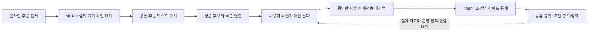

# 팀 시연·발표 설명 노트

D-049. Markdown 설명 노트이며 PPT 파일은 아니다. 발표 전에 RELEASE_GATES.md의 미확인 조건을 함께 확인한다.

## 1. 문제와 구조 설명 (약 1분)

온라인 주문 화면에서 상품명이 잘려 식품명 자체가 없어질 수 있다. 전체 상품명을 보존한 상품 레이어에서 후보를 찾고, 검토된 표준 식품 연결을 재사용한다. 후보가 서로 다른 식품이면 사용자가 확인한다. 소비기한은 조건과 근거가 일치할 때만 제안하며 없으면 미정이다.

## 2. 개발 앱 시연 (약 2분)

1. 5단계 모델 준비 및 최신 개발 APK 연결 후 홈의 상품 검색 검사에서 고유 prefix와 모호한 prefix를 비교한다. 합성 DB 7개/5개임을 먼저 알린다.
2. 온라인 주문 등록의 ‘합성 온라인 주문 예제’를 열고 구매일·후보를 확인한다. 사진 OCR 성공 시연이라고 부르지 않는다.
3. 품목을 등록하면 기한 미정으로 표시된다. 상세에서 포장지 날짜/내 예상 근거를 선택하고 저장한다.
4. 개발용 제출 화면에서 동의와 제출 대기열을 보여 준다. 실제 운영 계정/공개 데이터로 시험하지 않는다.
5. 정책은 비활성이다. 신뢰도/공개/철회 흐름은 아래 임시 합성 검증 결과로 설명한다.

## 3. PC 통합 검사 시연 (약 1분)

`python server/check_full_flow.py`는 파서→분류→등록→개인 저장→동의 제출→합성 검토→규칙 조회→철회를 실제 loopback HTTP로 실행한다. `python scripts/verify_stage8.py`는 13개 검증 그룹을 모아 검사한다. benchmarks/STAGE8_RESULTS.md를 함께 제시한다.

이미지 OCR, Android UI/SQLite 재실행, 운영 서비스가 이 PC 검사로 검증됐다고 말하지 않는다.

## 4. 공학적 비교 결과 (약 2분)

- 4단계 합성 test 12개: Jaccard 상품 Top-1 12/12, MiniLM INT8 5/12. 작은 문자 겹침 예제라 일반적인 우열을 결론 내리지 않는다.
- 5단계 같은 ONNX 계열 비교: FP32 약 470MB → 로컬 INT8 약 118MB. PC p50 약 3.7ms → 2.0ms. 모바일 지연은 미측정이며 FP32 Top-1도 낮아 문제를 양자화만의 영향으로 단정하지 않는다.
- 7단계 합성 극단값/반복 계정 실험: 필터 평균 10.0/10.1666. 숫자는 실제 식품 일수가 아니다. N은 정상 계정 수이고 실제 사람 수를 보증하지 않는다.
- 8단계 합성 다음 구매일 예측 5건: 증분 평균 MAE 약 3.033일, 직전 간격 4.2일. 이는 실제 소비량/소진일 오차가 아니다. 수량 1/2별 간격 차이도 합성 패턴이며 인과 효과로 주장하지 않는다.

원시 결과는 각 benchmarks JSON, 간단한 표는 STAGE4/5/7/8_RESULTS.md에 있다. 측정 환경·시각·모델/입력 해시를 함께 제시한다.

## 5. 현재 결론과 다음 검증

개발 코드와 합성 소프트웨어 검증 경로를 구성했다. 실제 온라인 주문·전체 상품 DB·기간 근거·실기기·운영 정책 검증과 최종 데이터 연결이 남아 있다. 사전학습 모델을 사용했으며 새 대형 모델을 학습하거나 실제 소비를 측정했다고 주장하지 않는다.
